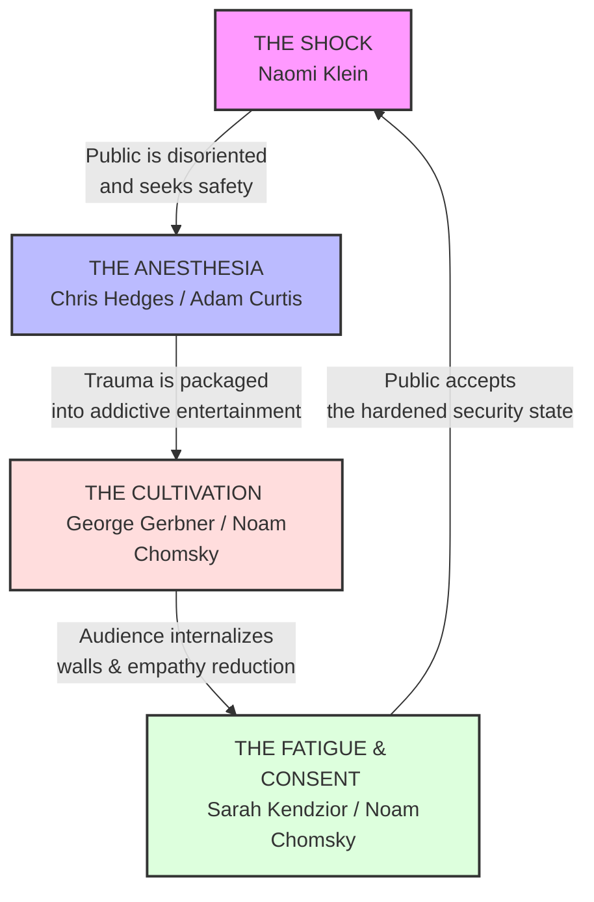

# Critical Talks: Analytics and Exposes

Societies develop intra- and inter-acting systemic behavior and structures, which
partially lead to grave injustice, brutality, and oppression.  
On this site, I write about my thoughts concerning issues I remark and verify.

The word "Talks" I'm using because I create the content with help of AI.
Therefore documents are structered with repeating blocks or "Question ..." and "Answer ...".

You can navigate each document with the Navigation in the right sidebar.

To diagram below shows a structure I verified in my first dossier:

## Active and first Dossier

* **[Volume 1: The Architecture of Moral Fatigue](./02.dystopian-media.md):** 
An investigation tracing how everything from streaming reality experiments and zombie fiction to 
Germany's ritualized "Memory Theater" and billionaire legal strategies work together to turn off our 
baseline empathy when state power demands it.

This archive will continue to grow as we dissect new walls, new surveillance structures, and new forms of
algorithmic control. Look at the gears, question the script, and refuse the anesthesia.
